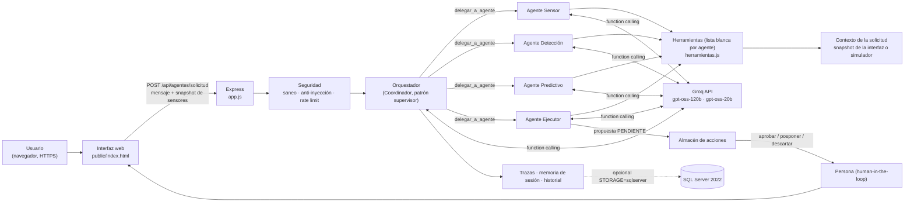
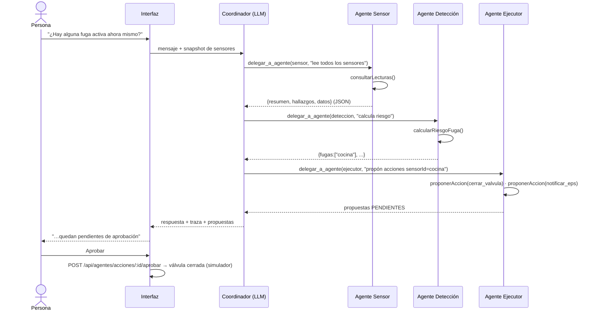

# Arquitectura de AquaSense IA

## Vista general (D5)

| Componente | Archivo | Función |
|---|---|---|
| Interfaz | `public/index.html` | Panel, chat, bandeja de aprobación, panel de trazas |
| API | `server/src/app.js` | Rutas, CORS restringido, CSP, rate limit, manejo de errores |
| Orquestador | `server/src/agents/orquestador.js` | Bucle del Coordinador, delegación, límites, traza |
| Definiciones | `server/src/agents/definiciones.js` | Prompts, herramientas permitidas por agente |
| Herramientas | `server/src/agents/herramientas.js` | Lógica determinista y validada; `proponerAccion` solo crea propuestas |
| Cliente LLM | `server/src/llm.js` | Groq (compatible OpenAI), timeout, reintentos, tope diario; modo `mock` |
| Almacenes | `server/src/almacenes.js` | Acciones, decisiones, trazas, memoria de sesión |
| Persistencia | `server/src/persistencia.js`, `db.js`, `schema.sql` | Réplica opcional en SQL Server |

## Flujo de una solicitud con fuga confirmada

## Decisiones de diseño

- **Patrón supervisor con delegación:** el Coordinador decide el orden dinámicamente (p. ej. solo llama al Ejecutor si Detección confirma una fuga). Un pipeline fijo no podría saltarse pasos ni responder fuera de dominio sin gastar llamadas.
- **Mínimo privilegio:** cada agente solo ve sus herramientas. El único que puede crear propuestas es el Ejecutor, y aun así no puede ejecutarlas. Si un LLM pidiera una herramienta ajena, el orquestador la bloquea y lo registra.
- **El LLM decide el flujo, el código decide los hechos:** el riesgo de fuga y la regla "no se propone cierre sin fuga confirmada" están en código determinista (`evaluarSensor`, `proponerAccion`), por lo que un modelo manipulado no puede saltárselas.
- **Modelos por rol:** modelo grande para coordinar y redactar; modelo pequeño (más barato y rápido) para tareas acotadas con herramientas.
- **Comunicación:** mensajes JSON estructurados `{resumen, hallazgos, datos}` validados por el orquestador (un reintento de formato; luego se tolera texto libre). No se usa MCP ni A2A.
- **Memoria:** estado de la solicitud en el orquestador; memoria de conversación por `sesionId` (últimos 6 turnos, 30 min); propuestas, historial y trazas en almacenes compartidos.

## Límites anti-bucle (E7)

| Control | Valor por defecto | Variable |
|---|---|---|
| Pasos del Coordinador | 6 | `MAX_PASOS_COORDINADOR` |
| Pasos por especialista | 4 | `MAX_PASOS_ESPECIALISTA` |
| Delegaciones por solicitud | 5 | `MAX_DELEGACIONES` |
| Llamadas al LLM por solicitud | 14 | `MAX_LLAMADAS_LLM` |
| Tiempo total por solicitud | 45 s | `TIMEOUT_SOLICITUD_MS` |
| Tiempo por herramienta | 3 s | `TIMEOUT_HERRAMIENTA_MS` |
| Timeout y reintentos del LLM | 20 s · 2 | `LLM_TIMEOUT_MS`, `LLM_REINTENTOS` |
| Llamadas al LLM por día | 500 | `TOPE_DIARIO_LLM` |

Al alcanzar un límite el sistema **no falla**: devuelve una respuesta parcial con lo que ya reunieron los agentes y marca `abortado` en la traza.
